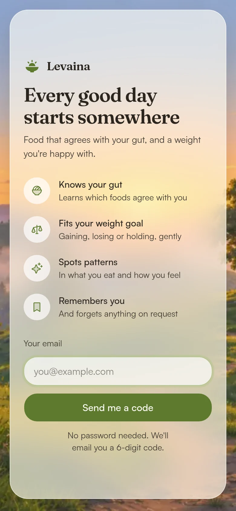
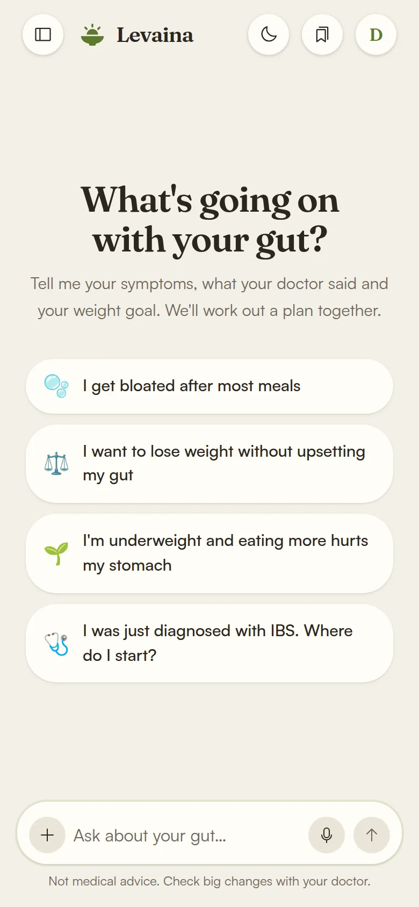
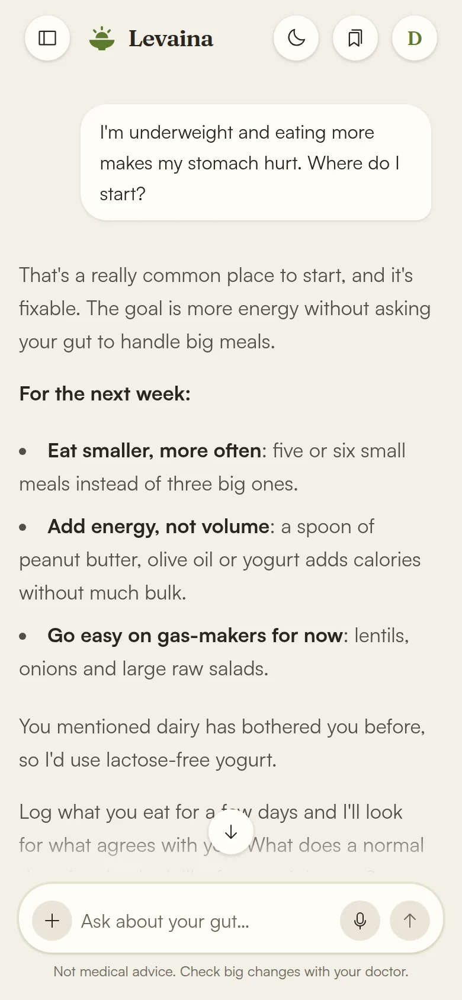
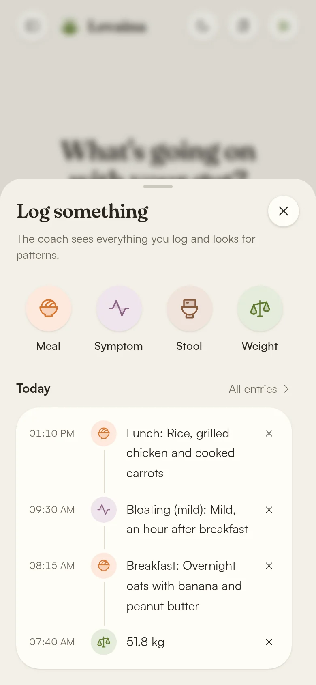
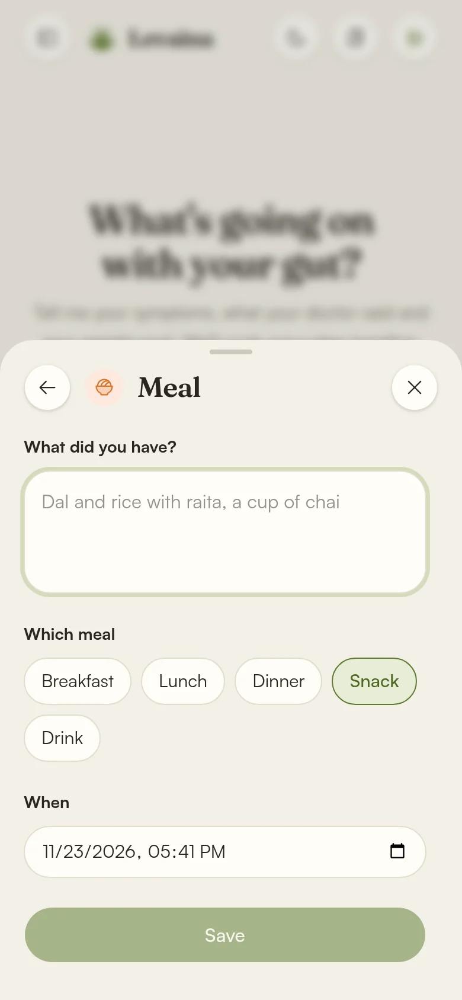
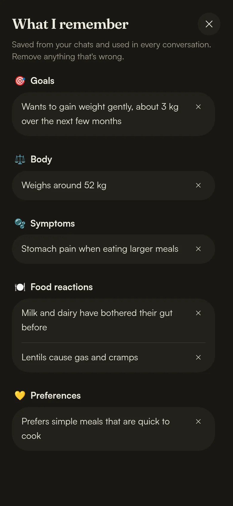
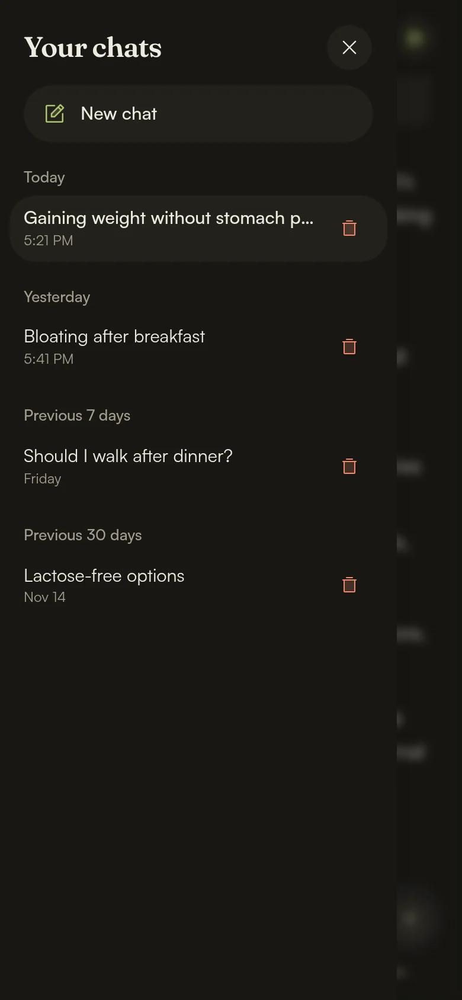
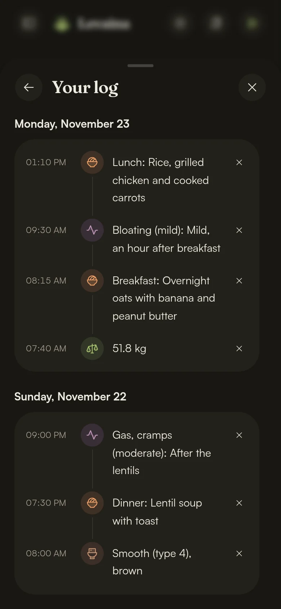

# Levaina

An AI coach for people with gut issues who also need to gain, lose or hold their weight.

Most diet apps count calories and most gut apps track symptoms. Levaina does both in one conversation: tell it what you ate and how you felt, and it remembers, logs it for you, and builds a plan around what your gut actually tolerates.

<table>
  <tr>
    <td align="center"><br /><sub>Sign in with a code</sub></td>
    <td align="center"><br /><sub>Start a conversation</sub></td>
    <td align="center"><br /><sub>A plan that fits your gut</sub></td>
    <td align="center"><br /><sub>Log in a tap</sub></td>
  </tr>
  <tr>
    <td align="center"><br /><sub>Meals, symptoms, stool, weight</sub></td>
    <td align="center"><br /><sub>See what it remembers</sub></td>
    <td align="center"><br /><sub>Pick up where you left off</sub></td>
    <td align="center"><br /><sub>Your whole log</sub></td>
  </tr>
</table>

## What it does

- **Coaches in plain language.** Asks what it needs to know, then gives a short, practical plan for your weight goal that avoids what upsets your gut.
- **Logs as you talk.** Say "had dal and rice, bloated an hour later" and the coach records the meal and the symptom. Or tap to log meals, symptoms, stool and weight yourself.
- **Remembers what matters.** Conditions, doctor's advice, food reactions and goals carry over to every conversation. You can see all of it, and remove anything that's wrong.
- **Reads your log.** The coach looks at your recent days to connect what you ate with how you felt.
- **No passwords.** Sign in with a 6-digit code sent to your email.
- **Feels calm.** Light and dark themes, soft motion, sheets you can swipe away, and full respect for reduced-motion settings.

## How it's built

- **Next.js 16** (App Router) and **React 19**, written in TypeScript
- **Vercel AI SDK** streaming replies from **Mistral Large**, with tool calls for logging and memory
- **Supabase**: Postgres with row-level security on every table, and email-code auth
- **Tailwind CSS v4** and **Base UI**, with Phosphor icons

Some choices worth a look:

- **The model can't quietly skip a field.** Tool inputs are required-but-nullable, so "not mentioned" has to be said on purpose, and a guard stops the same entry being saved twice in one reply.
- **Memory keeps its history.** Facts and dated episodes are kept apart, and a corrected fact is marked as replaced rather than overwritten.
- **Every user's data is walled off in the database itself**, not only in the app.
- **The interface is measured, not eyeballed.** Contrast, alignment, tap targets and motion are checked in a real browser across phone and desktop, light and dark.

## Run it locally

You'll need Node, pnpm, Docker (for local Supabase) and a Mistral API key.

```bash
pnpm install
supabase start
pnpm dev
```

Set your Mistral API key and the local Supabase URL and keys as environment variables, then open http://localhost:3000. Sign-in codes arrive in the local Supabase mail inbox.

---

Levaina gives general wellness guidance, not medical advice. Check big changes with your doctor.
